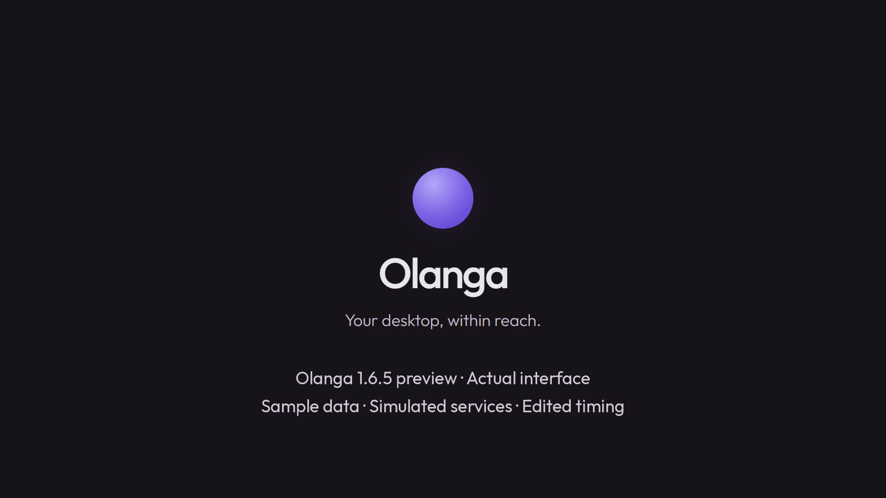

<p align="center">
  
</p>

<h1 align="center">Olanga</h1>

<p align="center"><strong>An open-source voice assistant for Windows.</strong></p>

<p align="center">
  <strong><a href="https://firestar3.github.io/Olanga-Desktop-Agent/">Olanga website</a></strong>
  · <a href="https://firestar3.github.io/Olanga-Desktop-Agent/#download">Download for Windows</a>
  · <a href="https://firestar3.github.io/Olanga-Desktop-Agent/#productfilm">Watch the film</a>
  · <a href="https://firestar3.github.io/Olanga-Desktop-Agent/docs.html">Docs</a>
</p>

Say **“Open Chrome, then move Chrome to the left.”** Olanga opens the browser, arranges its window and reports how each step went. You can also type commands on Home. Everyday app, volume, timer and checklist commands run locally. Add Gemini to ask about an error on your screen or review a proposed edit.

The corner orb stays within reach while you work in other apps. In **1.6.7**, you can pin a countdown or follow an NBA game beside it. Open Home to see the current Spotify track and control playback. [What’s new in 1.6.7](https://firestar3.github.io/Olanga-Desktop-Agent/whats-new.html)

## See it in action

[](https://firestar3.github.io/Olanga-Desktop-Agent/#productfilm)

Watch a Focus routine start a countdown, see Olanga recall a preference, and follow a screen edit up to the approval step. The film uses the 1.6.5 preview interface with sample data, simulated external services and edited timing. The player includes chapters, English captions and a transcript. [Watch the two-minute film](https://firestar3.github.io/Olanga-Desktop-Agent/#productfilm)

## Get started

1. Download the installer for **Windows 10 or 11 (x64)**, run it, and open Olanga. The current installer is unsigned. The GitHub release includes its checksum. [Download Olanga](https://firestar3.github.io/Olanga-Desktop-Agent/#download) · [Release assets](https://github.com/firestar3/Olanga-Desktop-Agent/releases/latest)
2. Select **Use local commands without a key**. On Home, type **“Set a timer for 25 minutes called Focus”** and press **Enter**. You’ll see Focus counting down under **Timers**.
3. Type **“Cancel the Focus timer”** to clear it. To try a spoken request, choose **On-device commands (English, review first)** under **Settings → Core settings → Speech recognition**. [First-command walkthrough](https://firestar3.github.io/Olanga-Desktop-Agent/docs.html#first-command) · [Voice setup](https://firestar3.github.io/Olanga-Desktop-Agent/docs.html#try-by-voice)

Voice input needs a microphone. For cloud transcription, conversation or screen assistance, add your Gemini key in **Core settings**. Cloud features require internet access and available provider quota. Olanga uses the built-in Windows voice by default. Optional NVIDIA Magpie voices use a separate key. [Get a Gemini key](https://aistudio.google.com/apikey) · [Get an NVIDIA key](https://build.nvidia.com/settings/api-keys)

## Everyday requests

| Try saying | What happens |
| --- | --- |
| “Play Spotify and raise the volume to 75%.” | Opens Spotify if needed, attempts playback, sets Windows volume and reports the result of each action. |
| “Play my liked songs on Spotify.” | Opens your Liked Songs collection and checks playback. |
| “Pause it.” / “What’s playing?” | Uses recent Spotify context to control playback or check the current track. |
| “Open Chrome, then move Chrome to the left.” | Opens and arranges a supported app window, checking each step. |
| “Set a timer for 25 minutes called Focus.” | Starts a named timer that keeps its saved deadline across restarts. |
| “Add buy milk to my tasks.” | Adds a checklist item. Ask to complete it or read your tasks later. |
| “Remind me to call Mom in 20 minutes.” | Saves a local reminder. Olanga must be running to alert you. |
| “Brief me.” | Reads the time, tasks and upcoming reminders, with headlines and weather when available. |
| “Explain the error on my screen.” | Asks to capture your screen, then uses Gemini to help explain it. |

Supported compound requests run in order. Completed steps remain completed if a later step fails; results distinguish success, failure and anything that could not be verified. Press **Escape** in Olanga to cancel the remaining work.

## Memory that follows the conversation

Tell Olanga “I live in Seattle” or “I prefer concise answers,” and it can retain those supported details without making you fill in a profile. Local rules learn clear statements you make directly; learned changes appear with **Undo**. Saved facts and recent conversation help follow-up questions make sense.

Ask **“What do you remember about me?”**, **“What memories did you use?”** or **“Stop learning.”** Review, edit or delete saved memories in Workspace. Learning and using existing memories have separate controls. Explicitly saved memories are protected from silent replacement.

**“Forget where I live”** removes your saved city and keeps your other preferences. If your city is part of a longer note, you can edit that note in Workspace or give Olanga its exact text to remove the whole note.

Learning stores supported personal details locally; it does not train a model or learn permission to act. Relevant enabled memories can accompany Gemini requests. Recent conversation expires automatically, while saved memories remain until you remove them.

## Your work, ready to resume

Open **Workspace** from the top bar to find the tools you use throughout the day.

- **Routines.** Say “Create a routine called Focus” to open its editor, then save the exact commands you want. “Run routine Focus” opens a step-by-step review. Choose the steps and confirm before they run.
- **Named workspaces.** Combine a saved app layout, project, browser or editor session and optional routine. Preview a workspace before resuming it, with a result for each part.
- **Files and projects.** Preview file renames and moves before applying them. Search a selected project locally, then review source excerpts before asking Gemini about them.
- **Notes, tasks and News.** Keep notes with version history, manage your checklist and read a topic-based news digest with publishers, dates and source links. Headlines need no Gemini key; AI questions are optional. Enable Notepad and News in User preferences.
- **Schedules and backups.** Set once, daily or weekly reminders. Export supported personal content and review what a restore will replace; imported timers stay paused and schedules disabled until you resume them.

Pin a timer under **Settings → User preferences → Timer card**. See the next timer beside the corner orb, expand up to five timers, or tuck the card away with its handle. Timers and live scores share one card position with a switch between them. The orb's temporary hide controls apply to both, and the timer card disappears when the last timer is dismissed.

Optional [browser and editor companions](extensions/README.md) connect selected tabs, documents and text to these workflows. [Phone remote](docs/PHONE_REMOTE.md), local model connections and reviewed MCP calls are available in Work tools when you need them.

## Help with what’s on your screen

Ask Olanga to explain a screen or prepare an edit in a supported app. **Desktop task**, below the command box, also opens this workflow directly.

1. Approve the screen capture and inspect the proposed target.
2. Review the action plan and confirm the Windows input before it runs.
3. See the result and what Olanga could verify from a fresh capture.

The capture includes your primary display. Selecting an edit region limits where Olanga can act; it does not crop the image shared with Gemini.

Supported input includes clicks, typing, scrolling and bounded keyboard shortcuts. Some full-field text replacements offer **Before**, **After** and a checked **Undo text edit**. Other edits may not have undo. Verification concerns the visible result; it does not establish that edited code compiles or passes tests.

Screen tasks are limited to supported, accessible controls on the primary display. Elevated windows and terminal automation are unsupported. The [architecture guide](docs/ARCHITECTURE.md) explains the review, scope and cancellation rules.

## Local commands, fewer waits

Olanga recognizes common app, music, volume, timer, memory and checklist requests on your PC. It can show each action’s result while the spoken reply is still playing. Questions outside the local command set can use Gemini. For timings on your own PC, open **Workspace → Diagnostics**. [Performance measurements and test coverage](docs/VALIDATION.md)

## Live scores and Spotify

Choose from all 30 NBA teams, with Golden State selected initially. The floating score card appears during a live game, checks ESPN about every 15 seconds and shows when updates are delayed. Its grip tucks the card into a slim strip while scores keep updating. When you enter Olanga, the floating card and orb make way for Home’s score and Spotify cards.

Enable scores in **Settings → User preferences → Live scores**. ESPN updates can lag the broadcast. For music, sign in to the Spotify desktop app and start a track on this PC. Olanga’s Home card reads the track from Spotify’s Windows media session. Library and playlist selection currently depend on English accessibility labels.

## Make Olanga yours

**User preferences** contains conversation style, accents, contrast, orb glow, reduced motion, startup and shortcuts. **Core settings** keeps provider keys, speech recognition, microphone selection and guided audio checks together. **Privacy** links to memory, activity and diagnostic controls.

The corner orb has five customizable shortcuts. Enable **Corner status light → All Lights** to keep it visible while idle. Its colors show the current state: purple for idle, green for listening, orange for working and blue for speaking.

Moving the pointer onto the bottom Windows taskbar hides the corner orb and its timer or score card. Move the pointer off the taskbar and the controls return without taking focus from your app.

Closing the window keeps Olanga running in the tray. Choose **Quit** from its tray menu to exit. Timers and reminders cannot alert while the app is closed or Windows is asleep.

## Updates, when you choose

Go to **Workspace → Apps & updates**, select **Check for updates**, then **Download update**. Once the installer is verified, choose **Install & restart** to update the existing installation and retain your saved data.

If your installed version only offers a release-page link, use the [Windows installer](https://firestar3.github.io/Olanga-Desktop-Agent/#download). To uninstall, search the Windows Start menu for **Add or remove programs**, find **Olanga**, and choose **Uninstall**. The privacy notice explains how to remove saved local data separately.

## Privacy

Wake-word detection runs locally. Idle microphone audio is not streamed to an AI provider. Activated cloud speech requests go to Gemini; questions can include relevant conversation and enabled memories. Screen assistance shares the images you approve. Magpie sends reply text to NVIDIA when selected.

API keys use Windows-backed encryption. Notes, memories, routines and other saved content stay in the local profile; most of that content is not encrypted by Olanga. There is no automatic analytics or crash-report upload. Optional diagnostics stay local unless you export and share them.

Read the [privacy notice](PRIVACY.md) for the data each feature shares, storage limits, provider policies and deletion controls. Do not post API keys, private screenshots or profile files in public issues.

## Run from source

Use Windows and Node.js **22.12 or later**:

```powershell
git clone https://github.com/firestar3/Olanga-Desktop-Agent.git
cd Olanga-Desktop-Agent
npm ci
npm start
```

For the static checks and unit suite:

```powershell
npm run check
npm test
```

The [validation guide](docs/VALIDATION.md) explains the separate renderer, voice and native checks, including those that interact with real apps. The [architecture guide](docs/ARCHITECTURE.md) covers the Electron app, local command path and integrations. Build instructions are in [Releasing](docs/RELEASING.md).

## Troubleshooting

If Olanga can’t hear you, Spotify opens without playing, or a Gemini request fails, the troubleshooting guide gives you a check you can run inside the app. If the problem persists, include your Olanga and Windows versions, the exact request, and the reply or error when you open an issue. [Troubleshooting guide](https://firestar3.github.io/Olanga-Desktop-Agent/docs.html#troubleshooting) · [Report a bug](https://github.com/firestar3/Olanga-Desktop-Agent/issues/new)

---

[Release notes](docs/releases/1.6.7.md) · [Privacy](PRIVACY.md) · [Architecture](docs/ARCHITECTURE.md) · [Validation](docs/VALIDATION.md) · [MIT license](LICENSE)
